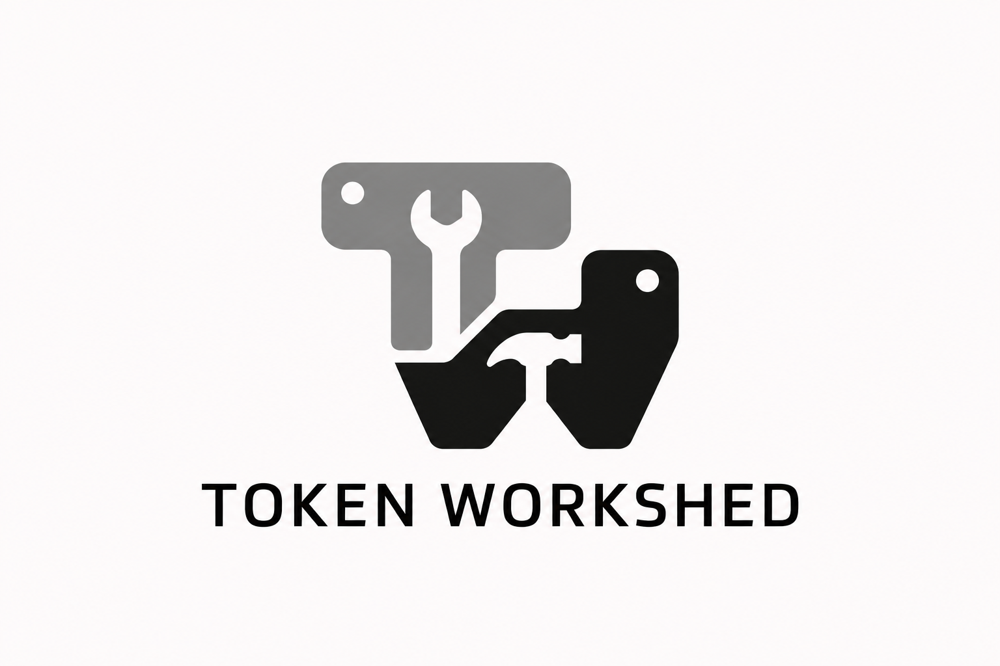

# Token Workshed NextCore

<div align="center">
  
  <p><strong>A native local AI workbench and Agent for Apple Silicon.</strong></p>
  <p>SGLang Runtime · optional remote RoboServer · macOS 14+</p>
</div>

<p align="center">
  <a href="https://github.com/Taylor-He/token-workshed-nextcore/releases/latest">Latest release</a>
  · <a href="docs/nextcore/README.md">Documentation</a>
  · <a href="https://github.com/Taylor-He/token-workshed-nextcore/issues">Report an issue</a>
</p>

NextCore keeps models and Agent data on the Mac or RoboServer you choose. Its
app-owned Agent can use web, files, terminal, browser, and computer tools from
the NextCore chat window. The inference runtime is SGLang; there is no
vLLM-MLX fallback.

## Download

- [Full installer](https://github.com/Taylor-He/token-workshed-nextcore/releases/download/v0.2.1/token-workshed-nextcore-0.2.1-full.pkg) — first installation.
- [App update](https://github.com/Taylor-He/token-workshed-nextcore/releases/download/v0.2.1/token-workshed-nextcore-0.2.1-update.pkg) — update an existing NextCore installation.
- [RoboServer 0.1.0 for a remote Mac](https://github.com/Taylor-He/token-workshed-nextcore/releases/download/v0.2.1/token-workshed-roboserver-0.1.0-macos-arm64.zip) — install on the Apple Silicon Mac you want to connect to.
- [Release notes](RELEASE_NOTES_v0.2.1.md) · [All releases](https://github.com/Taylor-He/token-workshed-nextcore/releases)

**Requirements:** macOS 14 or later on Apple Silicon (`arm64`). The installer
sets up the pinned SGLang runtime over the network. Model weights are
downloaded separately. This release is not Developer ID signed or notarized;
Gatekeeper may prevent it from opening normally.

## What is included

- **SGLang runtime:** SGLang Runtime `v0.5.22`, pinned to commit
  `baa9befa381511cd4d56f83980951e5a45fffc6d`, with Python 3.12.
- **Chat and API:** native chat, streaming, completions, and the existing
  OpenAI-compatible inference routes.
- **NextCore Agent:** an app-owned SGLang tool loop for web search and reading,
  files, terminal, browser, computer use, MCP connections, memories, and Skills.
  Agent tools are available only from authenticated in-app chat.
- **RoboServer:** optional SSH connection to a separate Apple Silicon Mac.
  Model serving and model files stay on the selected Mac; the management API
  is reached through a private SSH tunnel.
- **Workshed:** teacher generation, benchmarks, and evaluation use SGLang.
  Loss scoring uses the temporary Torch/MPS SGLang backend.

## Runtime and safety

- Text generation uses SGLang's MLX backend. The app does not run models with
  MLX-LM or vLLM-MLX.
- OpenAI-compatible API, ACP, MCP, and IDE connections are inference-only;
  they cannot invoke NextCore's computer, browser, terminal, or file tools.
- macOS privacy permissions remain in force. NextCore does not bypass system
  protections or elevate commands.
- Image, video, speech recognition, and speech generation remain unavailable
  until validated for each model and macOS runtime. SGLang-Omni is separate
  and experimental, not a fallback.
- Saved 0.2.1 training and conversion work orders remain readable, but steps
  that NextCore no longer supports are rejected before execution.

## Build from source

```bash
python3.12 -m venv .venv
source .venv/bin/activate
python -m pip install --upgrade pip setuptools wheel
python -m pip install -e '.[ide]'
scripts/install_sglang_runtime.sh
token-workshed-nextcore-desktop
```

The default local inference and app API ports are `8010` and `7872`. See the
[installation guide](docs/nextcore/installation.md), [RoboServer guide](docs/nextcore/roboserver.md),
and [Workshed guide](docs/nextcore/workshed.md).

## Project history and attribution

The active NextCore source line is on `main`. Earlier Token Workshed history
is preserved on [`legacy/pre-nextcore-history`](https://github.com/Taylor-He/token-workshed-nextcore/tree/legacy/pre-nextcore-history).
Third-party notices and licenses remain with the source; see [NOTICE](NOTICE)
and [LICENSE](LICENSE).

Current maintainer: [Taylor-He](https://github.com/Taylor-He).
